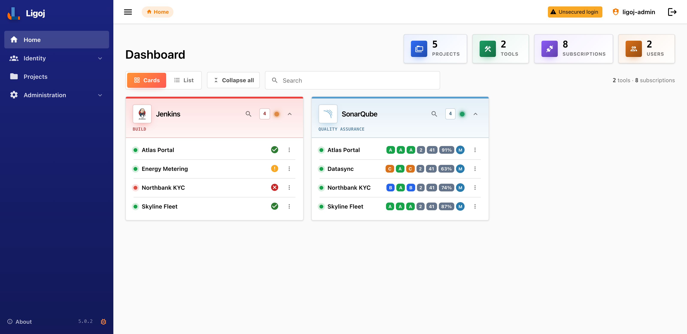
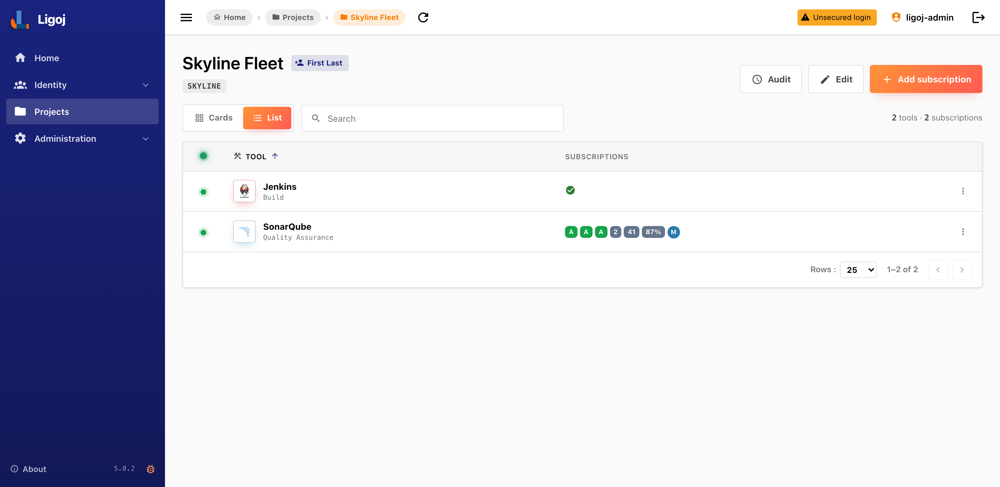
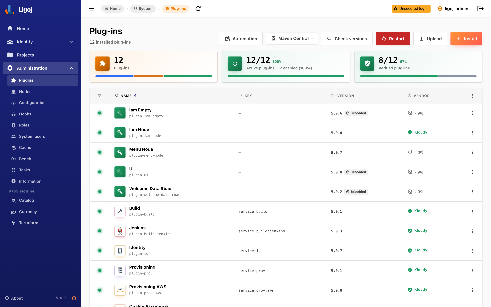
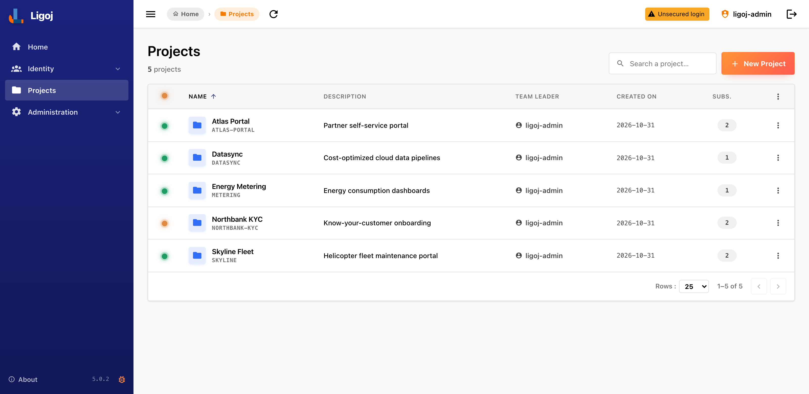
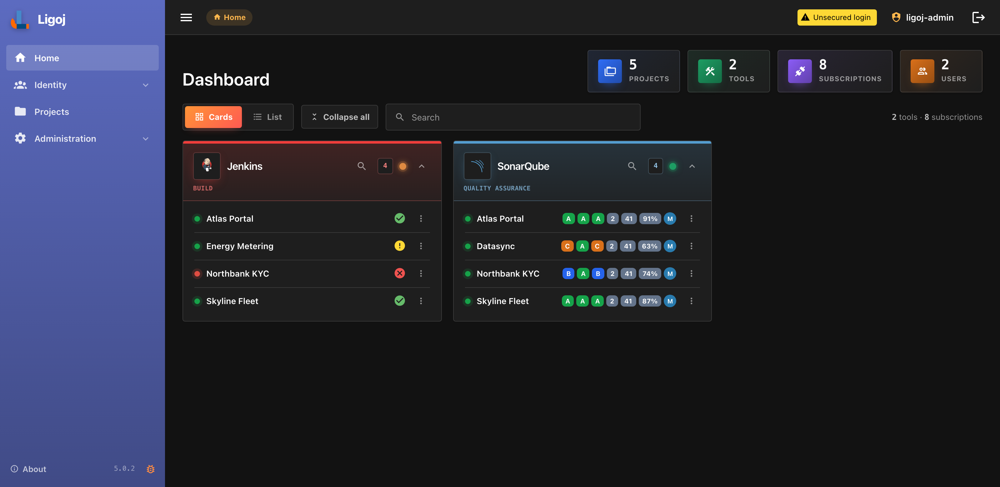
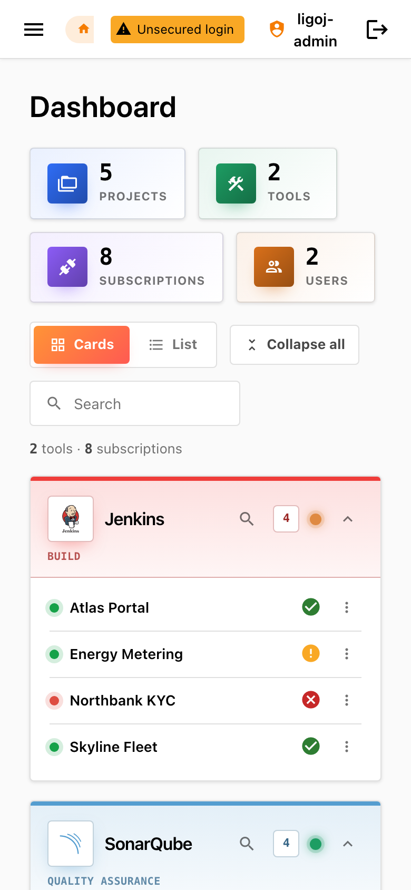
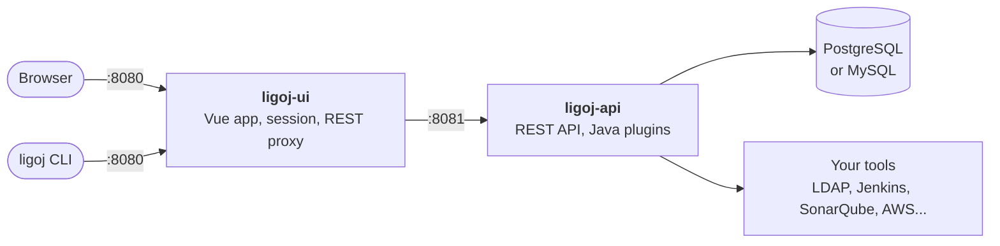

<div align="center">


# Ligoj

**The open-source project portal.**
One place for the tools, access rights, health and cloud costs of every project.

[](https://github.com/ligoj/ligoj/releases)
[](LICENSE)
[](https://hub.docker.com/r/ligoj/ligoj-api)
[](https://pypi.org/project/ligoj-cli/)


[Quick start](#quick-start) · [Screenshots](#screenshots) · [CLI](#cli-reference) · [Plugins](#plugins) · [Deployment](#deployment) · [Documentation](#documentation)

<br>



</div>

## Why Ligoj?

Each project uses a build server, a quality gate, a registry, a cloud account and an identity directory. Ligoj connects them, so teams and administrators work from one portal instead of a dozen consoles.

| | |
|---|---|
| **Projects and subscriptions** | Each project subscribes to tool instances. Their health and key metrics come together on one dashboard. |
| **Everything is a plugin** | Tools, identity providers and features are plugins, installed and updated at runtime, with [code signature checks](DOC.md#plugin-code-signing). |
| **Security built in** | [RBAC](DOC.md#security) with regex-based UI and API rules, delegated administration, API tokens, OAuth2/OIDC login, multi-factor authentication and an [audit trail](DOC.md#audit). |
| **Cloud cost management** | Provisioning plugins bring catalog-aware cost estimation and optimization to each project. |
| **API-first** | Every feature is a REST endpoint, browsable through the [OpenAPI explorer](DOC.md#openapi) and scriptable with the [CLI](#cli-reference). |
| **Modern and self-hosted** | A Vue 3 and Vuetify 4 interface with dark mode, English and French, on a Java 25 and Spring Boot 4 API, shipped as Docker images and a Helm chart. |

## Screenshots

<table>
  <tr>
    <td width="50%"><br><sub><b>Project view:</b> the subscribed tools and their live metrics</sub></td>
    <td width="50%"><br><sub><b>Plugin manager:</b> install, update and verify signatures</sub></td>
  </tr>
  <tr>
    <td width="50%"><br><sub><b>Project list:</b> search and manage every project</sub></td>
    <td width="50%"><br><sub><b>Dark mode:</b> several color themes and styles are built in</sub></td>
  </tr>
</table>

<details>
<summary>Mobile view</summary>
<br>

</details>

<sub>Screenshots use fictional projects and sample tool data.</sub>

## Quick start

You need [Podman with `podman-compose`](DOC.md#prerequisites), or Docker Compose. This starts the published images with PostgreSQL:

```bash
git clone https://github.com/ligoj/ligoj.git && cd ligoj

cat > .env <<EOF
LIGOJ_REGISTRY=docker.io/
LIGOJ_VERSION=5.0.2
EOF

podman compose -p ligoj -f compose.yml -f compose-override.yml up -d
```

Open <http://localhost:8080/ligoj> and sign in as `ligoj-admin` with the password `ligoj-admin`. A regular user, `ligoj-user`, is also created.

> [!WARNING]
> **This setup is for evaluation only.** The default identity plugin accepts any password, which the app bar flags as "Unsecured login". Before production, see [Going to production](#going-to-production).

Plugins, logs and the database persist in the named volumes `ligoj-home` and `ligoj-db-data`. To keep them in host directories instead, see [Persistent Ligoj home](DOC.md#persistent-ligoj-home).

To build the images from source instead, add `--build` to the last command. See [Building the Docker images](DOC.md#building-the-docker-images).

## CLI reference

The [`ligoj` CLI](https://github.com/ligoj/cli) drives the REST API from a terminal or a pipeline. It needs Python 3.11 or later.

```bash
uv tool install ligoj-cli        # or: pipx install ligoj-cli, or: pip install ligoj-cli
mkdir -p ~/.ligoj

export LIGOJ_ENDPOINT=http://localhost:8080/ligoj
export LIGOJ_API_USER=ligoj-admin

ligoj session login --password ligoj-admin   # opens a temporary session
ligoj token create --save --id cli           # creates a durable API key and saves it
ligoj session logout                         # the API key takes over
ligoj session whoami
```

### Everyday commands

```bash
ligoj info version                                                   # server version
ligoj -o text project list                                           # global options come first
ligoj project create --pkey demo --name "Demo" --team-leader ligoj-admin
ligoj plugin list
ligoj plugin install --id plugin-qa                                  # install parents first
ligoj plugin install --id plugin-qa-sonarqube
ligoj plugin restart                                                 # loads the new plugins
ligoj subscription list
ligoj cache invalidate --id nodes
```

### Commands

| Area | Command | Actions |
|---|---|---|
| **Access** | `session` | `login` `logout` `whoami` `get` |
| | `token` | `create` `list` `get` `delete` `purge` `purge-all` |
| | `user` | `list` `get` `upsert` `delete` |
| | `role` | `list` `get` `create` `delete` |
| **Projects** | `project` | `list` `get` `create` `delete` |
| | `subscription` | `list` `get` `create` `delete` `status` `refresh` |
| **Platform** | `info` | `version` `status` `all` `api` |
| | `plugin` | `list` `install` `upload` `javadoc` `restart` |
| | `node` | `list` `get` `status` `create` `upsert` `delete` |
| | `configuration` | `get` `set` `delete` |
| | `cache` | `list` `get` `invalidate` |
| | `hook` | `list` `get` `upsert` `delete` |
| | `file` | `get` `put` `delete` |
| **Identity** | `id:user` | `create` `get` `list` `delete` `reset-password` `add` `remove` |
| | `id:group` | `create` `import` `get` `list` `delete` |
| | `id:scope` `id:ou` `id:delegate-node` `id:delegate-org` | Scopes, organizational units and delegation |
| **Cloud costs** | `prov:quote` | `get` `locations` `refresh` `refresh-cost` `update` |
| | `prov:instance` `prov:database` `prov:container` `prov:function` `prov:storage` | Quote resources |
| | `prov:support` `prov:usage` `prov:budget` `prov:optimizer` `prov:tag` `prov:catalog` `prov:upload` | Quote settings, price catalogs and CSV upload |
| **Tools** | `build:job` `jenkins` `sonar` `nexus` `harbor` `gitlab` `argocd` `alfresco` | Tool-specific operations |
| **Automation** | `bootstrap` | `init` `create-project` `delete-project` `create-nested-project` `create-roles` `delete-roles` `welcome-user` |
| | `dev` | A local development environment with its backing services |
| | `update` | Update the CLI |

### Global options

| Option | Environment variable | Purpose |
|---|---|---|
| `-e`, `--endpoint` | `LIGOJ_ENDPOINT` | Ligoj URL |
| `-u`, `--api-user` | `LIGOJ_API_USER` | User name |
| `--api-key` | `LIGOJ_API_KEY` | API key |
| `--profile` | `LIGOJ_PROFILE` | A profile from `~/.ligoj/config` and `~/.ligoj/credentials` |
| `-o`, `--output` | `LIGOJ_OUTPUT` | `json`, `text` or `table` |
| `-k`, `--insecure` | | Allow insecure TLS connections |
| `-G`, `--debug` | | Debug logs |

Each level has its own help, for example `ligoj project create -h`. The full reference is in the [CLI documentation](https://github.com/ligoj/cli#readme), and instance setup with the CLI is in [Configuration with CLI](DOC.md#configuration-with-cli).

## Plugins

These plugins are published on [Maven Central](https://central.sonatype.com/namespace/org.ligoj.plugin) for the 5.x generation, and were loaded together on API 5.0.2:

| Domain | Plugins |
|---|---|
| **Identity** | `plugin-id` · `plugin-id-ldap` · `plugin-id-sql` · `plugin-id-cognito` · `plugin-iam-node` · `plugin-password` |
| **Build** | `plugin-build` · `plugin-build-jenkins` |
| **Code quality** | `plugin-qa` · `plugin-qa-sonarqube` |
| **Registry** | `plugin-registry` · `plugin-registry-nexus` |
| **Cloud costs** | `plugin-prov` · `plugin-prov-aws` |
| **Mail** | `plugin-mail` · `plugin-mail-smtp` |
| **Interface** | `plugin-ui`, embedded in the API |

> [!IMPORTANT]
> A tool plugin needs its parent plugin: `plugin-qa-sonarqube` needs `plugin-qa`. Install the parent first: a plugin with a missing parent is not loaded, and an error in the API log names what is missing.

Older generations of other plugins exist on Maven Central, and not all of them run on 5.x. To write your own, see [Creating your own plugin](DOC.md#creating-your-own-plugin) and [plugin-api](https://github.com/ligoj/plugin-api).

## Deployment



| Target | Start with |
|---|---|
| **Docker or Podman Compose** | [Deployment with Docker Compose](DOC.md#deployment-with-docker-compose) · [Compose variables](DOC.md#custom-docker-compose-variables) · [MySQL or PostgreSQL](DOC.md#use-mysql-or-postgresql-databases) |
| **Kubernetes** | `helm install ligoj ./charts/ligoj` · [Helm installation](DOC.md#kubernetes-installation-helm) · [chart reference](charts/ligoj/README.md) |
| **Containers** | [Docker execution](DOC.md#docker-execution) · [`ligoj/ligoj-api`](https://hub.docker.com/r/ligoj/ligoj-api) · [`ligoj/ligoj-ui`](https://hub.docker.com/r/ligoj/ligoj-ui) |

### Going to production

- **Identity:** replace the default identity plugin with a real provider, such as `plugin-id` with `plugin-id-ldap`, `plugin-id-sql` or `plugin-id-cognito`, or use [OAuth2/OIDC login](DOC.md#login).
- **Encryption:** replace the default `app.crypto.password=public` with your own secret through `LIGOJ_API_CRYPTO` and `LIGOJ_WEB_CRYPTO`. See [Encryption](DOC.md#encryption).
- **Database:** set your own `LIGOJ_DB_PASSWORD`, or use an [existing database server](DOC.md#existing-database-server).
- **Administrator:** review the [initial user settings](DOC.md#administrator-user-reinitialisation).
- **Network:** expose only `ligoj-ui`, behind TLS. `ligoj-api` must stay internal.

## Documentation

The full documentation is in **[DOC.md](DOC.md)**.

| Topic | Read |
|---|---|
| **Concepts** | [Architecture](DOC.md#architecture) · [Features](DOC.md#features) · [Subscriptions](DOC.md#subscription) |
| **Security** | [Security and RBAC](DOC.md#security) · [Login modes](DOC.md#login) · [API tokens](DOC.md#api-tokens) · [Audit](DOC.md#audit) |
| **Plugins** | [Plugin management](DOC.md#plugin-management) · [Installation](DOC.md#plugin-installation) · [Code signing](DOC.md#plugin-code-signing) · [Extension points](DOC.md#plugins-extension-points) |
| **Operations** | [Application properties](DOC.md#application-level-properties) · [Logs](DOC.md#logs) · [Management endpoints and SBOM](DOC.md#management-endpoints) · [Troubleshooting](DOC.md#troubleshooting) |
| **Integration** | [REST API and OpenAPI](DOC.md#openapi) · [Hooks](DOC.md#hook-configuration) · [Files](DOC.md#file-configuration) · [Branding the UI](DOC.md#customization-of-the-ui) |
| **Development** | [Backend](DOC.md#development) · [Frontend with Vite](DOC.md#frontend-development-vite) · [Interface architecture](DOC.md#ui) · [Packaging](DOC.md#packaging) · [Dev setup wiki](https://github.com/ligoj/ligoj/wiki/Dev-Setup) |
| **Compatibility** | [Databases and Java](DOC.md#compatibilities) |
| **Releases** | [Changelog](CHANGELOG.md) · [Version française](CHANGELOG.fr.md) · [GitHub releases](https://github.com/ligoj/ligoj/releases) |

## Contributing

Bug reports and pull requests are welcome through [GitHub issues](https://github.com/ligoj/ligoj/issues). Please read the [code of conduct](CODE_OF_CONDUCT.md) and the [development guidelines](DOC.md#guidelines).

## License

[MIT](LICENSE) · [](https://app.fossa.io/projects/git%2Bgithub.com%2Fligoj%2Fligoj?ref=badge_shield)
